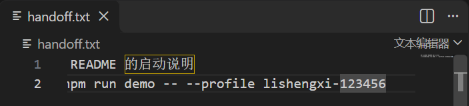
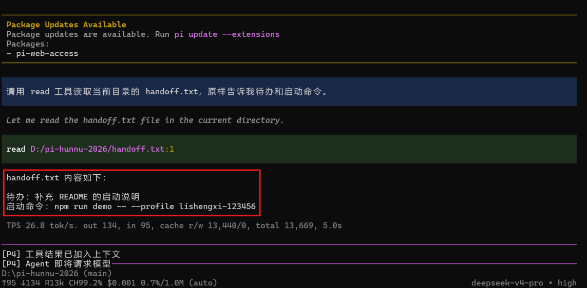
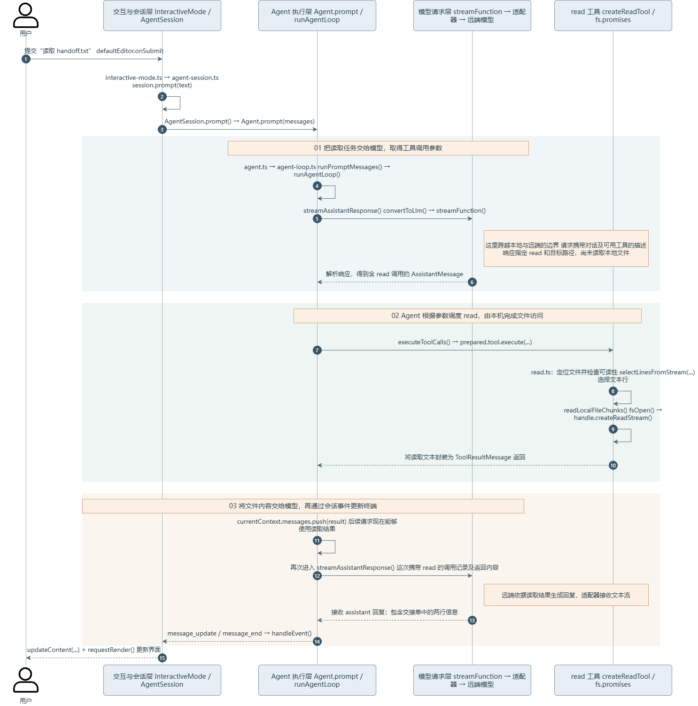
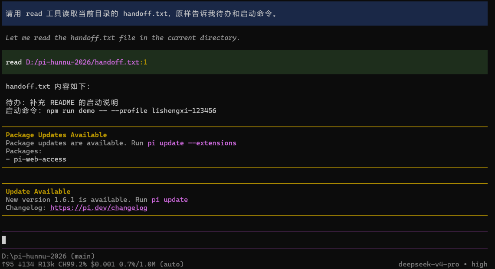
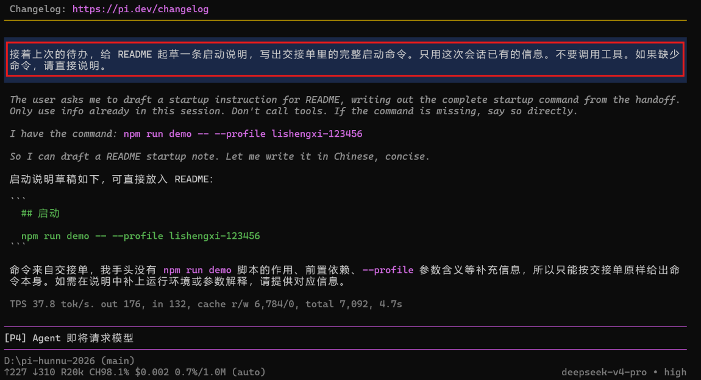
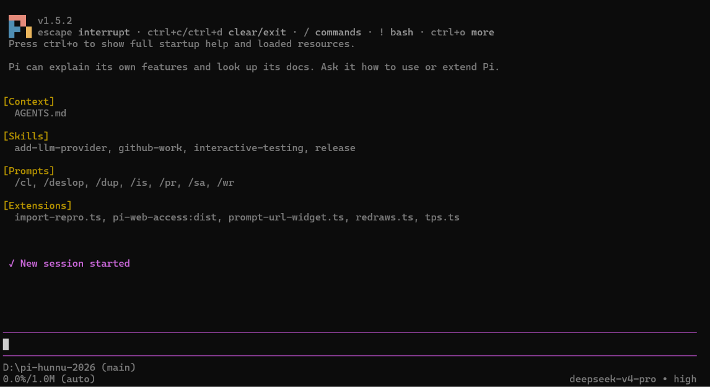
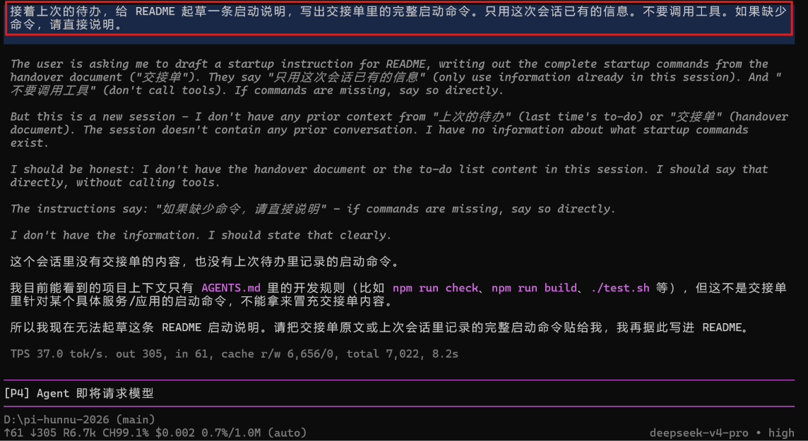
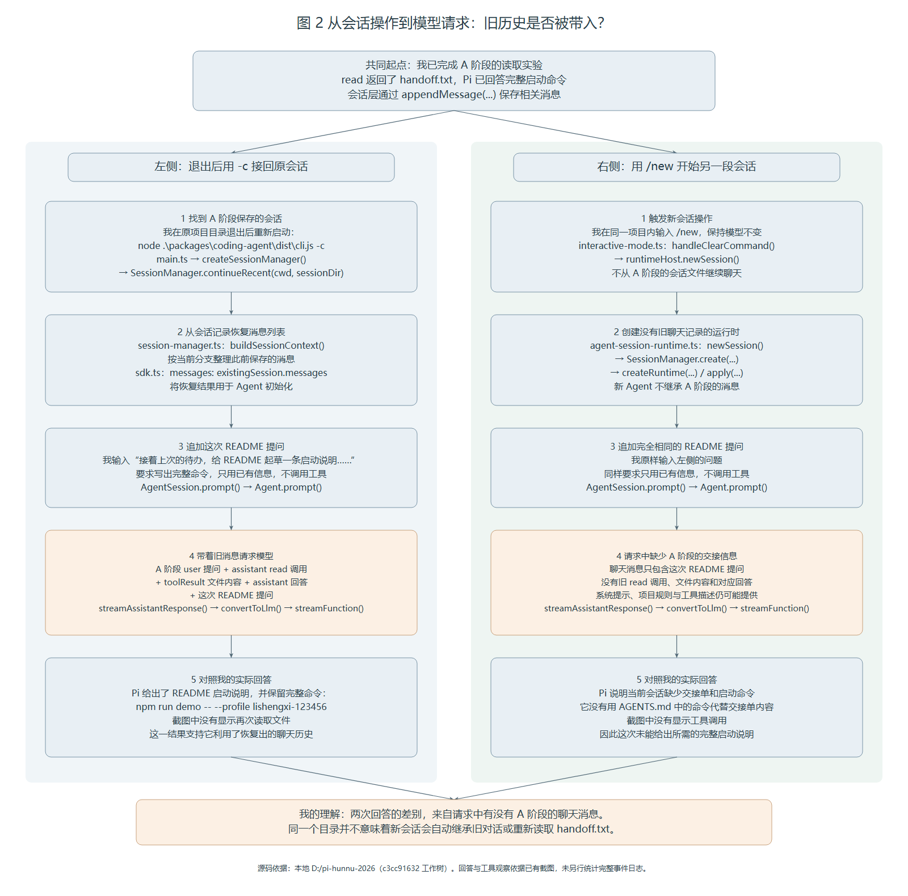

# 实践 05：Pi Agent 工具调用与会话恢复

## 1. 实验目标与环境

这次我先让 Pi 读取一份本地交接单，再顺着这次操作去找源码里的输入入口、工具调用和回复显示位置。完成读取后，我又分别试了恢复旧会话和新建会话：在项目目录和模型都不变的情况下，问同一个问题，看看 Pi 还能不能写出交接单里的启动命令。

| 项目 | 本次使用的环境 |
| --- | --- |
| 系统与终端 | Windows、PowerShell |
| Pi 源码和实验工作目录 | `D:\pi-hunnu-2026` |
| 启动方式 | `node .\packages\coding-agent\dist\cli.js` |
| 界面显示的 Pi 版本 | `v1.5.2` |
| 实验模型 | `deepseek-v4-pro`，界面显示思考级别为 `high` |
| 交接单 | `D:\pi-hunnu-2026\handoff.txt` |
| 报告及图片所在仓库 | `LSX-item/pi-practice-05` |
| 源码核对版本 | 本地仓库 HEAD 为 `c3cc91632`，以下分析以当前工作树为依据 |

我核对源码时使用的是上面记录的本地版本。由于没有另外核验 `dist` 与工作树是否完全一致，下面会把终端里的观察和源码中的处理过程分开说明。

我在 `handoff.txt` 里写了下面两行，用 `lishengxi-123456` 作为这次实验的标识。这条命令主要用来检查 Pi 有没有获得交接单内容，实验里不需要真正执行它。

```text
待办：补充 README 的启动说明
启动命令：npm run demo -- --profile lishengxi-123456
```



## 2. 阶段 A：读取交接单，追踪一次用户交互

### 2.1 操作与观察

我在源码项目根目录启动本地构建的 Pi，然后在新会话里输入下面这句话。提问中只告诉它文件名，没有给出启动命令：

```text
请用 read 工具读取当前目录的 handoff.txt，原样告诉我待办和启动命令。
```



提交后，我在终端里看到了 `read D:/pi-hunnu-2026/handoff.txt:1`，截图中展示了 1 次 read 调用。Pi 随后给出了“补充 README 的启动说明”和完整的 `npm run demo -- --profile lishengxi-123456`，与交接单内容一致。

我还注意到终端里的两条调试输出：`[P4] 工具结果已加入上下文` 和 `[P4] Agent 即将请求模型`。结合源码，我把这轮交互理解为：模型先要求调用 read，本地读取文件，再把结果交给模型组织回答。所以图 1 画了两次模型调用的正常路径。这里的“两次”是我结合源码整理的主流程，现有截图没有覆盖完整请求日志，不能单独用来统计所有重试。

### 2.2 图 1：单轮工具调用的代码级时序图

画图时，我把相关对象按职责合并成五条生命线：用户、交互与会话层、Agent 执行层、模型请求层和 read 工具。这样可以先看清各层之间的关系，再通过箭头上的函数名回到具体文件。



### 2.3 调用路径与职责

我先从输入框的提交回调找起，顺着 `session.prompt()` 和 `agent.prompt()` 往下读，再回头查回答是怎么显示到终端上的。下面是我整理出的几个关键位置，路径都相对于源码项目根目录。

| 环节 | 源码位置 | 行为 |
| --- | --- | --- |
| 接收输入 | `packages/coding-agent/src/modes/interactive/interactive-mode.ts:3325` | `defaultEditor.onSubmit` 接收编辑器文本，正常提问进入 `session.prompt(text)`。 |
| 将会话输入交给 Agent | `packages/coding-agent/src/core/agent-session.ts:2175`、`:1982` | `AgentSession.prompt()` 进入会话处理流程，准备好本次消息后调用 `await this.agent.prompt(messages)`。 |
| 启动执行循环 | `packages/agent/src/agent.ts:382`、`:441` | `Agent.prompt()` 规范化输入，调用 `runPromptMessages()`，再跨文件进入 `agent-loop.ts` 的 `runAgentLoop()` 和内部 `runLoop()`。 |
| 请求模型 | `packages/agent/src/agent-loop.ts:391` | `streamAssistantResponse()` 先执行上下文转换与 `config.convertToLlm(messages)`，然后调用 `streamFunction(config.model, llmContext, options)`。 |
| 调度工具 | `packages/agent/src/agent-loop.ts:279`、`:837` | 从 assistant 消息中提取工具调用，经 `executeToolCalls()` 调度，最终执行 `prepared.tool.execute(...)`。 |
| 使用工具返回值 | `packages/agent/src/agent-loop.ts:284` | `currentContext.messages.push(result)` 将 `toolResult` 放入上下文。正常情况下循环继续，让模型利用新增的文件内容。 |
| 显示回复 | `packages/coding-agent/src/modes/interactive/interactive-mode.ts:3525`、`:3649`、`:3685` | `session.subscribe(...)` 将事件交给 `handleEvent()`；`message_update` 更新流式内容，`message_end` 完成当前消息的显示。 |
| 保存消息 | `packages/coding-agent/src/core/agent-session.ts:1232` | 会话层在相应消息结束处理过程中调用 `sessionManager.appendMessage(event.message)`，为之后恢复会话保留记录。 |

### 2.4 两个需要分清的边界

**请求模型的位置。** 我在 `streamAssistantResponse()` 里找到了 `streamFunction(...)`。它会把请求交给配置选定的模型实现，由适配器完成消息格式转换和远端通信。我另外查看了 OpenAI 兼容实现，在 `packages/ai/src/api/openai-completions.ts` 中可以看到 `client.chat.completions.create(...)`。不过，截图只能确认模型显示名称，不能确定实际的 `model.api`，所以这里把它作为适配器示例。

读到这里，我分清了“模型要求调用 read”和“本地已经读完文件”的区别。模型返回的是工具名和参数，后面的文件访问还需要 Agent 调度本地 read 工具来完成。

**读取文件的位置。** 我继续查看了 `packages/coding-agent/src/core/tools/read.ts`，发现默认操作里配置了 `createReadStream: readLocalFileChunks`。对于本次普通文本的默认行范围，源码会进入 `selectLinesFromStream(...)`，先通过 `fsOpen(path, "r")` 打开文件，再用 `handle.createReadStream(...)` 读取和选择文本行。

我也看到了另一条 `selectLinesFromBuffer(await ops.readFile(...), ...)` 分支，它用于没有流式实现或不适合流式处理的范围。因此，我在图 1 里按本地源码的默认文本路径标出了流式读取，没有直接套用其他版本的 Buffer 读取说明。这个判断来自源码核对，终端截图本身看不出底层采用哪种读取方式。

## 3. 阶段 B：相同提问在两种会话中的结果

### 3.1 恢复旧会话

A 阶段完成后，我先退出 Pi，再留在同一个项目目录执行下面的命令，用 `-c` 恢复最近的会话：

```powershell
node .\packages\coding-agent\dist\cli.js -c
```

重新进入后，我先确认终端里能看到之前读取交接单的对话：



确认历史记录恢复后，我输入下面的提问，要求它只使用这次会话已有的信息，并且不要调用工具：

```text
接着上次的待办，给 README 起草一条启动说明，写出交接单里的完整启动命令。只用这次会话已有的信息。不要调用工具。如果缺少命令，请直接说明。
```



这次 Pi 给出了一段 README 启动说明，其中的命令仍然是交接单里的完整内容：

```sh
npm run demo -- --profile lishengxi-123456
```

我看到它还说明了自己不知道脚本作用、前置依赖和参数含义，只能按交接单提供命令。保存的这段记录里没有出现新的工具调用。结合恢复后能看到的旧对话，我认为这个结果支持它使用了恢复出来的历史信息。

### 3.2 新建会话

接着，我在同一个项目内输入 `/new`，没有更换模型。界面出现了新会话提示：



我把刚才的提问原样再输入了一次，得到下面的回答：



这次它没有写出实验命令，而是说明当前会话里没有交接单，也没有上次待办中的启动命令。我注意到它仍然能提到 `AGENTS.md` 里的开发命令，但没有把那些命令当成交接单的内容。这段记录里也没有出现工具调用。

| 对照项目 | 使用 `-c` 恢复 | 使用 `/new` 新建 |
| --- | --- | --- |
| 项目目录与模型 | `D:\pi-hunnu-2026`、`deepseek-v4-pro` | 保持相同 |
| 提问内容 | 要求从会话已有信息起草 README 说明，不调用工具 | 与左侧完全相同 |
| A 阶段聊天记录 | 能在恢复界面看到 | 不继承到新会话 |
| 回答中的完整实验命令 | 有，标识为 `lishengxi-123456` | 没有，说明信息不足 |
| 工具观察 | 提供的截图未见新增工具调用 | 提供的截图未见工具调用 |
| 源码解释 | 已恢复的消息连同新提问参与请求 | 聊天消息中缺少 A 阶段读取结果 |

我把两次结果放在上表中比较。工具调用一栏按我保存的截图记录填写，没有另外从完整事件日志统计次数。

### 3.3 图 2：会话恢复与新建的上下文对照

为了把回答差异和源码对应起来，我重新画了下面这张对照图。两边都从 A 阶段结束开始，依次画出会话操作、历史消息准备、输入同一问题、组装模型请求和最后的回答。



### 3.4 会话差异在源码中的位置

**我先查了 `-c` 是怎样找到旧会话的。** 在 `packages/coding-agent/src/main.ts:479`，`parsed.continue` 为真时会调用 `SessionManager.continueRecent(cwd, sessionDir)`。接着我在 `core/session-manager.ts:1811` 找到这个函数，它通过 `findMostRecentSession(...)` 查找对应目录最近的会话文件。本次重启前我最后使用的就是 A 阶段会话，恢复界面里也确实出现了那段记录。

接下来，我在 `core/sdk.ts:210` 看到了 `sessionManager.buildSessionContext()`，创建 Agent 时又用到了 `messages: existingSession.messages`。这就把会话文件和模型请求联系起来了：A 阶段的提问、工具调用、读取结果及回答被恢复为消息，再和我的新提问一起参与请求。这里恢复的是按当前分支组织的上下文；如果触发了历史压缩，还会按相应规则处理，并不是直接把整个会话文件原样发送出去。

**然后我查了 `/new` 的处理过程。** 本地版本的 `interactive-mode.ts:7117` 中，`handleClearCommand()` 调用的是 `runtimeHost.newSession()`。继续往下看，`core/agent-session-runtime.ts:226` 的 `newSession()` 创建新的 `SessionManager`，再通过 `createRuntime(...)` 和 `apply(...)` 替换当前运行时。新会话初始化时没有 A 阶段的聊天消息，所以我再问同一个问题，模型也无法从旧聊天记录里找到命令。

新会话的回答让我注意到一个细节：清掉旧聊天记录后，项目规则还可能被加载。它能提到 `AGENTS.md`，却不知道交接单里的命令，说明这两类信息的来源不同。

## 4. 我整理的修改位置与实验收获

顺着这两次实验读完后，我也整理了以后修改不同功能时可以先去看的文件：

| 后续希望修改的行为 | 优先阅读的位置 | 原因 |
| --- | --- | --- |
| 输入提交、工具展示、回复刷新 | `interactive-mode.ts` 的编辑器回调和 `handleEvent()` | 这里连接用户操作与终端组件。 |
| 工具参数处理、文本读取、内容截断 | `core/tools/read.ts` | 文件系统访问及读取结果组织在工具实现中完成。 |
| 工具调度、再次请求模型的条件 | `packages/agent/src/agent-loop.ts` | 循环在这里检查工具调用并追加工具结果。 |
| 会话文件查找、历史消息重建 | `core/session-manager.ts`、`core/sdk.ts` | 前者管理持久化和上下文构建，后者使用已有消息初始化 Agent。 |
| 新会话创建及运行时替换 | `core/agent-session-runtime.ts` | 当前版本的新建会话生命周期在此协调。 |

这次实验里，我觉得最需要分清的是“一轮提问”和“一次模型请求”。我只输入了一次读取要求，但 Agent 还需要经过请求模型、执行工具、带着结果继续请求等步骤，才能完成回答。

恢复会话的对比也让我更容易理解 Pi 为什么能接着上次的话题回答：旧会话里的内容会被重新整理进消息列表。输入 `/new` 后，即使文件还在原目录、模型也没有换，新的聊天历史里仍然没有那条启动命令。以后遇到类似“为什么它记得”或“为什么它不知道”的问题，我会先检查实际带给模型的消息，而不只看界面上是否还在同一个项目里。
